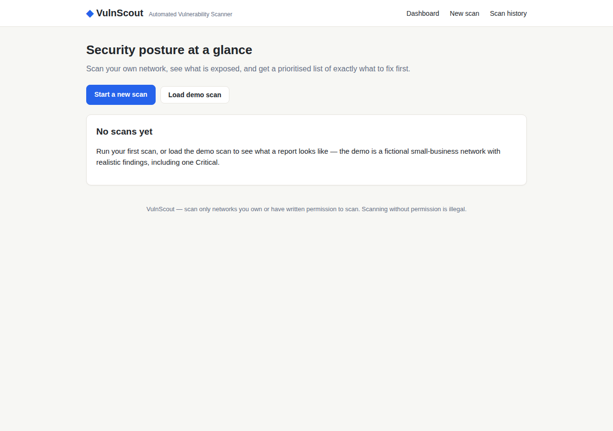
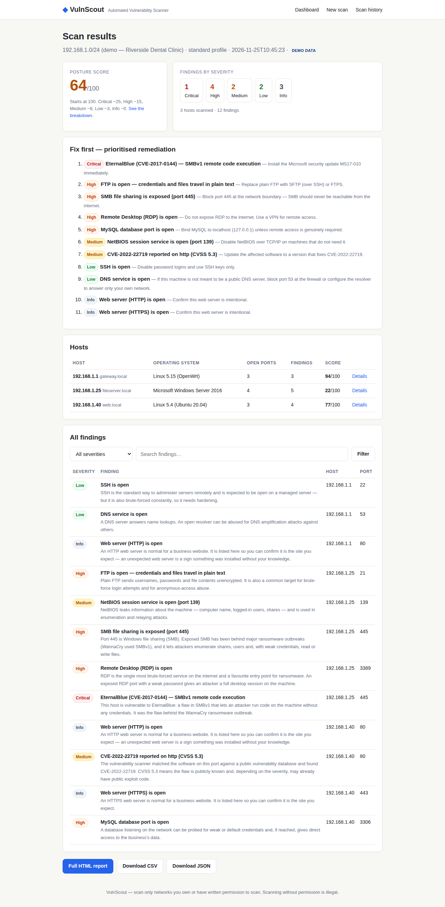
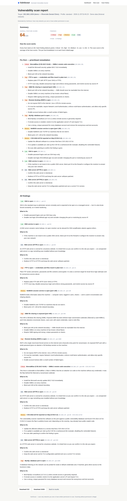

# VulnScout — Automated Vulnerability Scanner


A small business runs a scan against its own network and gets an actionable report: what is exposed, how bad it is, and exactly what to fix first.

VulnScout drives [Nmap](https://nmap.org/) from Python, parses its XML output with a custom pure-Python parser, turns open ports and NSE script results into severity-rated findings with plain-language explanations and concrete remediation steps, and scores the whole network 0–100.

> **Only scan networks you own or have written permission to scan. Scanning without permission is illegal.** Every scan in VulnScout requires an explicit authorisation checkbox, and targets are capped at a /24.

| Dashboard | Scan results | Report |
| --- | --- | --- |
|  |  |  |

## Features

- **Three scan profiles** — Quick, Standard (default), Deep. See below.
- **Explainable posture score (0–100)** — every host starts at 100 and each finding deducts points; the breakdown is shown on every host page, so the number is a sum you can audit.
- **Actionable findings** — every finding has a severity, a plain-language explanation, concrete remediation steps, and references (CVE links where available).
- **"Fix first" list** — remediation steps prioritised Critical → High → Medium → Low, with duplicates collapsed.
- **Scan history** — every scan is stored in SQLite (target, profile, date, findings, score) and can be re-opened or deleted.
- **Exports** — HTML report, CSV and JSON per scan.
- **Demo mode** — a seeded fictional small-business network (a dental clinic) with realistic findings, including one Critical, so the whole UI is explorable without Nmap or network access.
- **CLI** — `python -m vulnscout scan <target> --profile standard` for terminal use.
- **Authorisation gate** — the web UI and the CLI both refuse to scan without explicit confirmation.

## Scan profiles

| Profile | What it runs | When to use |
| --- | --- | --- |
| **Quick** | Top 100 ports, service/version detection | A fast check of a single host |
| **Standard** | Top 1,000 ports, service/version detection, OS detection, NSE vulnerability scripts (`vulners`, `ssl-heartbleed`, `ssl-poodle`, `http-vuln-cve2017-5638`) | The recommended default |
| **Deep** | All 65,535 ports, service/version detection, OS detection, the full NSE `vuln` script suite | Overnight, or for a first baseline |

All profiles use TCP connect scans (`-sT`) rather than SYN scans, so VulnScout works without root or raw-socket privileges. OS detection (`-O`) still needs privileges; when it is unavailable Nmap skips it and the scan continues.

## How findings are scored

Every host starts at **100**. Each finding deducts points by severity:

| Severity | Deduction |
| --- | --- |
| Critical | −25 |
| High | −15 |
| Medium | −8 |
| Low | −3 |
| Info | −0 |

The host score is floored at 0. The scan score is the rounded mean of the host scores.

CVE severities come from their CVSS score: ≥ 9.0 Critical, ≥ 7.0 High, ≥ 4.0 Medium, > 0 Low. Port-exposure severities come from a curated table in `vulnscout/findings.py` — for example Telnet (23) is Critical because credentials travel in plain text, exposed SMB (445) and RDP (3389) are High, and an open web server is Info (it is normal, but you should confirm it is the site you expect).

## Install

### Requirements

- Python 3.10+
- Nmap 7.80+ (only needed for live scans — the demo works without it)

### Install Nmap

- **Linux (Debian/Ubuntu):** `sudo apt install nmap`
- **macOS:** `brew install nmap`
- **Windows:** download the installer from [nmap.org](https://nmap.org/)

### Run locally

```bash
git clone https://github.com/DareToCrack/vulnscout.git
cd vulnscout
python -m venv .venv
source .venv/bin/activate        # Windows: .venv\Scripts\activate
pip install -r requirements.txt
python run.py
```

Open http://127.0.0.1:5000 — then either start a scan (tick the authorisation box) or load the demo scan.

### Run with Docker

```bash
docker build -t vulnscout .
docker run -p 5000:5000 -v vulnscout-data:/app/data vulnscout
```

Open http://127.0.0.1:5000. The scan history persists in the `vulnscout-data` volume.

> **No Vercel / serverless deployment:** Nmap is a local binary and cannot run on serverless platforms. VulnScout is a local or Docker tool by design.

### CLI

```bash
python -m vulnscout scan 192.168.1.0/24 --profile standard
python -m vulnscout scan 127.0.0.1 --profile quick --json -y
```

The CLI asks for interactive authorisation confirmation unless `-y` is given (you must still actually be authorised).

## Architecture

```
vulnscout/
├── vulnscout/
│   ├── nmap_runner.py    Target validation, scan profiles, subprocess runner
│   ├── parser.py         Pure-Python Nmap XML parser (no Nmap needed to test)
│   ├── findings.py       Severity mapping, remediation, scoring
│   ├── demo.py           Seeded fictional small-business network
│   ├── db.py             SQLite scan history
│   ├── app.py            Flask app: dashboard, scan, results, report, exports
│   ├── __main__.py       CLI
│   ├── templates/        Jinja templates (light theme)
│   └── static/style.css  Light theme stylesheet
├── tests/                pytest suites + Nmap XML fixtures
├── docs/screenshots/    dashboard, scan results, report
├── Dockerfile
├── requirements.txt      Flask only — the Nmap parser has no dependencies
└── run.py
```

Data flow: target → validation + authorisation gate → `nmap -oX -` (background thread) → XML parser → findings engine → SQLite → dashboard / results / report / CSV / JSON.

## Tests

```
python -m pytest tests/ -q    # 54 tests
```

The suites cover the XML parser (fixture files — no Nmap needed), severity and CVSS mapping, scoring math and the zero floor, target validation (including the /24 cap and the authorisation refusal), demo data (exactly one Critical, known scores), the Flask routes and exports, and — when Nmap is installed — a real quick scan of localhost and the CLI.

## Limitations (honest)

- **Scanning without authorisation is illegal.** VulnScout enforces a confirmation step, but the responsibility is yours.
- **The `vulners` NSE script needs network access** to query the Vulners database, and full results may need a free Vulners API key (`--script-args vulners.apikey=...`). Without it, CVE mapping is limited.
- **OS detection needs privileges.** Without root / raw-socket access, Nmap skips `-O` and the OS is reported as unknown.
- **Results depend on the installed Nmap version** — script names, output formats and the CVE database all come from Nmap, not from VulnScout.
- **A scan finds what is reachable, not what is safe.** A clean scan is not proof a network is secure — it is a snapshot of exposed services at one moment.
- **Demo data is synthetic.** The Riverside Dental Clinic network is fictional; its findings are illustrative.

## License

MIT — see [LICENSE](LICENSE).
